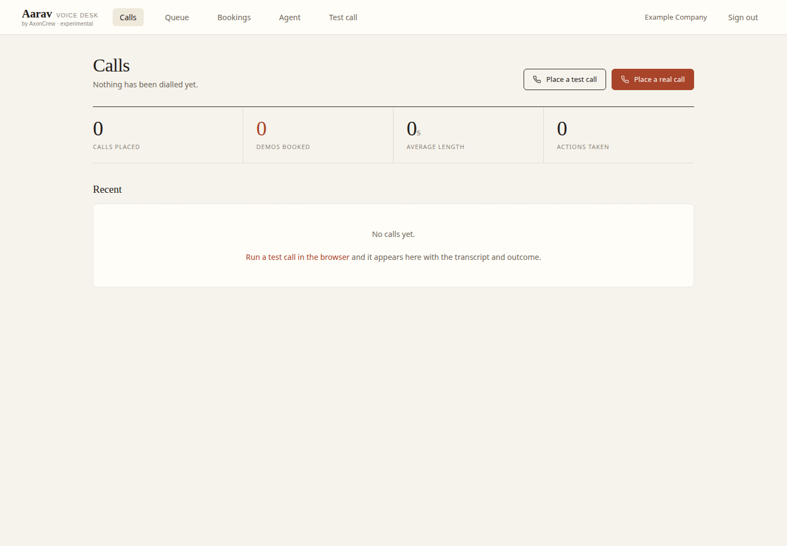
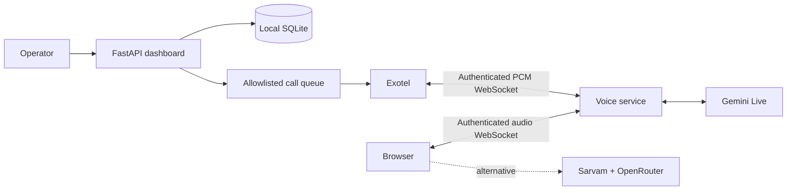

# Memeostan Voice

An experimental, self-hosted **Exotel voice-agent starter** for Hindi and Hinglish conversations. Python, FastAPI, a small browser dashboard, and your own provider accounts.

[](https://github.com/shivasaini04/memeostan-voice/actions/workflows/checks.yml)
[](LICENSE)

Use it to learn Exotel's audio protocol, try a browser voice agent, customize a company-specific conversation, or prototype calls to **numbers you own and have explicitly allowlisted**. Provider usage and phone calls may cost money; open-source code does not include provider credits.

**v0.1 is an experimental starter for one trusted operator, with one server worker and at most two audio sessions.** It is not a managed calling service or a finished multi-tenant SaaS. No production-readiness or response-latency guarantee is made.



## What is included

| Component | Purpose |
| --- | --- |
| Exotel Voicebot WebSocket | Authenticated, bidirectional PCM audio with a Gemini Live agent |
| Browser voice demo | Microphone streaming, audio playback, and interruption handling |
| Alternative browser engine | Sarvam STT/TTS + OpenRouter text model |
| Operator dashboard | Company facts, call history, transcripts, queue, and local bookings |
| Outbound worker | Explicit Exotel origination, test-number gate, retry queue, idempotency key |
| Optional tools | Local demo reservations; email calendar invitation only when enabled |

The calendar is a **local SQLite booking ledger**. It does not check Google Calendar or Microsoft 365. Twilio, WhatsApp, website scraping, arbitrary outcome webhooks, public signup, and regulatory DND lookup are outside this release.



## Install and open locally

Supported target: **Linux, Python 3.13 or 3.14**. The compatibility dependency `audioop-lts` supplies the audio helpers removed from Python's standard library. Other platforms are not yet verified.

```sh
git clone https://github.com/shivasaini04/memeostan-voice.git
cd memeostan-voice
python3 -m venv .venv
. .venv/bin/activate
python -m pip install -r requirements.txt
cp .env.example .env
python manage.py create-operator
python -m uvicorn server:app --host 127.0.0.1 --port 8000 --workers 1 --no-access-log
```

Open **http://localhost:8000**, sign in with the account created by the CLI, then edit **Agent** with your company name, offer, and verified facts. The origin must match `PUBLIC_ORIGIN` exactly. The supplied cookie setting is for local HTTP; remote use requires HTTPS and `COOKIE_SECURE=1`.

The CLI prompts for your password without echoing it. There is no default account and no public signup. Set `VOICE_TENANT_ID` to the value printed by the CLI if it differs from `1`.

### Try the browser voice demo

Set `GEMINI_API_KEY` in `.env`, restart the server, then open `/demo` and select Gemini. Alternatively configure `SARVAM_API_KEY` and `OPENROUTER_API_KEY` for the Sarvam browser engine. Microphone access requires localhost or HTTPS.

Model identifiers in `.env.example` are starting values, not a promise of ongoing provider availability. Choose a Live audio model and speech voices supported by your account. The app never opens a provider connection at startup. Starting a voice session sends audio and context to the selected providers. Post-call outcome extraction can make a separate Gemini text request.

## Connect Exotel

1. Provision your Exotel account, ExoPhone, and a Voicebot-enabled App Bazaar flow. Provider access, trial restrictions, and account approval remain your responsibility.
2. Run `python manage.py configure-exotel`. Supply the operator's account SID, API key/token, caller ID, and **flow URL**. Credentials are saved in your private SQLite database. There is no shared-account fallback.
3. Generate a separate incoming-stream password: `python -c 'import secrets; print(secrets.token_urlsafe(32))'`. Put it in `.env` as `EXOTEL_STREAM_PASSWORD`; set `EXOTEL_STREAM_USER` as well. These are app credentials, separate from your carrier API credentials.
4. Put the app behind HTTPS/WSS. Set `PUBLIC_ORIGIN=https://your-host.example`, `COOKIE_SECURE=1`, and restart. Keep one worker. Use a reverse proxy with body/time limits, TLS, and access logging that excludes credentials and personal data.
5. Configure the Voicebot applet's WSS URL as:
   ```text
   wss://<stream-user>:<stream-password>@your-host.example/api/v1/telephony/exotel/stream
   ```
   Exotel documents that it sends these credentials as an HTTP Basic `Authorization` header. The server validates that header **before accepting audio**. Do not put carrier account keys in this URL.
6. Use the `start.media_format.sample_rate` sent by Exotel as the negotiated audio rate. This starter supports 8, 16, and 24 kHz PCM input. Exotel telephony uses Gemini; Sarvam is available in the browser demo.

Exotel's flow URL is a separate value, typically `http://my.exotel.com/<account-sid>/exoml/start_voice/<app-id>`. It is the flow to run after dialing; it is not the WebSocket URL.

See Exotel's [Voicebot setup and authentication](https://support.exotel.com/support/solutions/articles/3000108630-working-with-the-stream-and-voicebot-applet), [call-flow API](https://developer.exotel.com/docs/agentstream/connect-voice-ai-flow), and [AgentStream protocol](https://developer.exotel.com/docs/agentstream/websocket-protocol). Confirm the flow and media settings for your own account.

### Place a deliberate test call

Outbound calling starts disabled. Set all required controls in `.env`:

```dotenv
ENABLE_OUTBOUND_CALLS=1
ALLOWED_TEST_NUMBERS=<your-owned-number-in-E164-format>
SUPPRESSED_NUMBERS=
```

Only your own authorized test numbers belong on this list. The gate checks number syntax, explicit enablement, allowlist, local suppression, and the configured example IST window. It **does not perform a real DND lookup, verify consent, or certify compliance**. Carrier and applicable calling/recording requirements still apply.

Run `python trigger_exotel_call.py` to place one call; it asks you to type `CALL`. Or enqueue from the dashboard and run `python dialer.py` in another terminal. Keep `.env` synchronized and restart both processes after changes.

The authenticated `POST /api/v1/trigger` endpoint accepts `phone`, `name`, `reason`, `context`, and `trigger_key`. The dashboard shows the operator's `X-API-Key` and an example request. Reuse the same `trigger_key` when retrying an event to avoid duplicate queue entries. Calls still pass the gate at origination.

## Privacy, limits, and deletion

- `.env`, databases, logs, generated media, and virtual environments are ignored by Git. Protect their filesystem permissions and backups; Exotel credentials are stored in local SQLite, not encrypted by this app.
- Call transcripts, history, outcomes, and booking details are stored in SQLite even when audio recording is off. Provider-side copies are governed separately by your account's terms and retention settings.
- `RECORD_CALLS=0`, `FILE_LOGGING=0`, `ENABLE_EMAIL=0`, and private debug logging off are the defaults. Enabling recording or debug logs creates sensitive local data. Obtain appropriate consent before recording.
- Audio sessions default to 180 seconds, with a hard ceiling of 600 seconds and two active sessions per server. Request/frame limits and a process-local rate limiter reduce accidental overuse; **they do not impose a monetary budget**. Set provider-side spending limits.
- If someone asks not to be contacted, stop and add them to `SUPPRESSED_NUMBERS`; the prompt cannot update a carrier DND registry or promise removal by itself.
- Stop the server and worker, then run `python manage.py purge-call-data` to delete local call history, queue, transcripts, outcomes, bookings, and recordings. Delete backups and provider data separately. Do not run this during a call.

## Development

```sh
python -m pip install -r requirements-dev.txt
python -m pytest -q
pip-audit -r requirements.txt --no-deps --disable-pip
```

The tests use temporary databases, synthetic PCM, mocked media handlers, and blocked provider networking. CI covers Linux/Python 3.13 and 3.14. Paid inference and real carrier calls are not part of automated verification. Provider availability, real-world latency, echo behavior, and a complete phone call need explicit integration testing with your account.

Dependencies are pinned in `requirements.txt`; `requirements.in` records the direct dependency ranges. Re-resolve in a clean environment when updating, then run tests and the vulnerability audit. See [release checks](RELEASE_CHECKS.md), [security policy](SECURITY.md), and [contributing](CONTRIBUTING.md).

## License and origin

MIT. Built by [AxonCrew](https://axoncrew.com), extracted from our standalone voice prototype with applicable NanoCrew/NanoClaw notices preserved. This repository contains no production database, call recordings, deployment credentials, or private infrastructure configuration. See [LICENSE](LICENSE) and [third-party notices](THIRD_PARTY_NOTICES.md).

Questions: **hello@axoncrew.com**. Bugs and contributions are welcome through GitHub issues and pull requests. Please report sensitive vulnerabilities privately.
